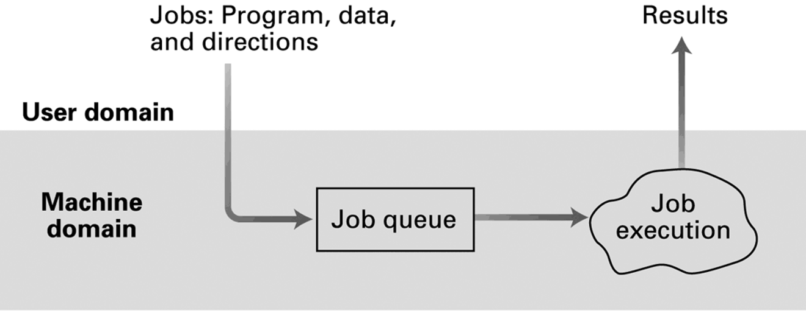
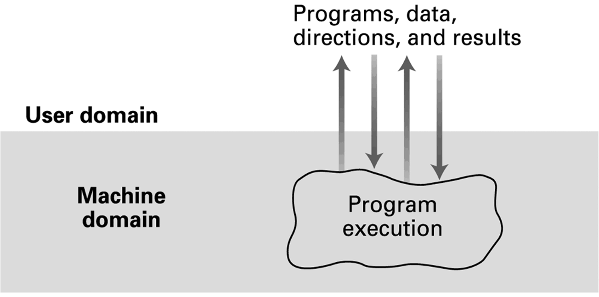
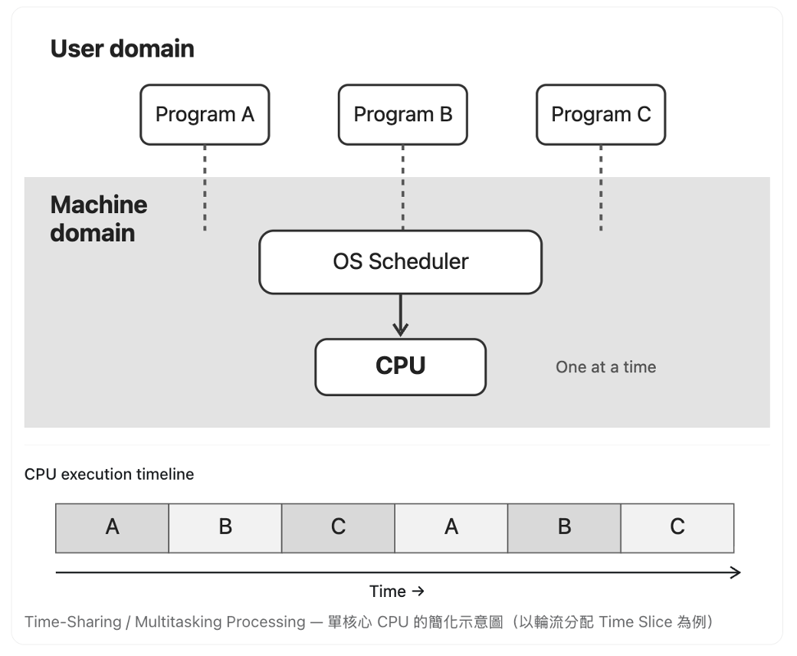
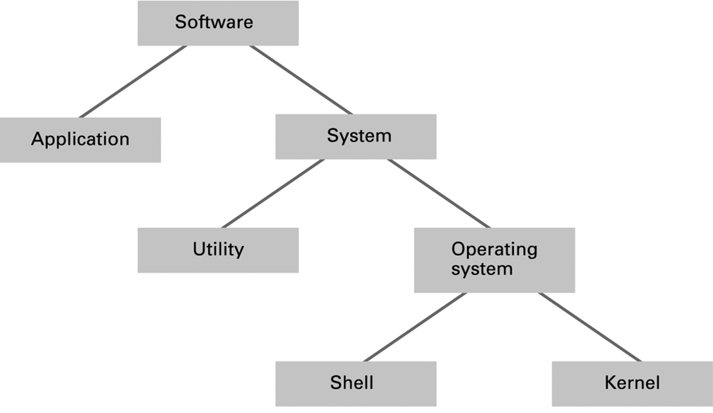
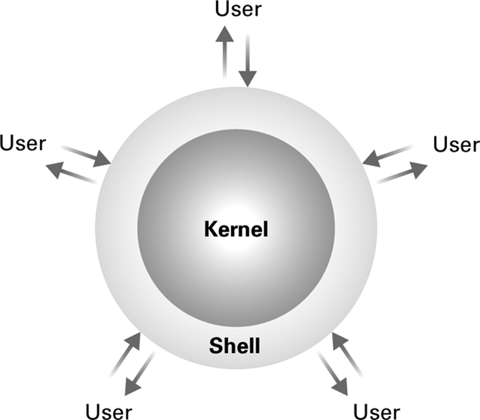
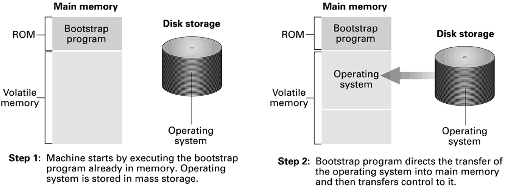
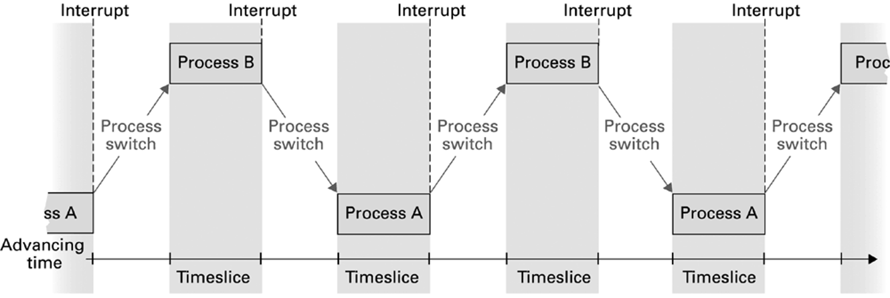
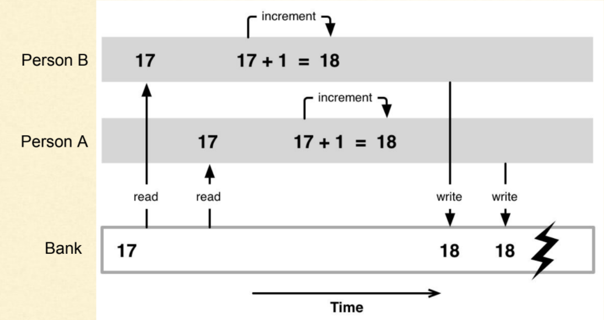
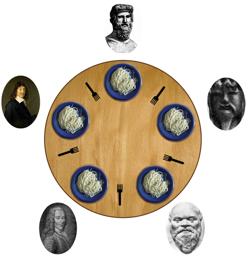
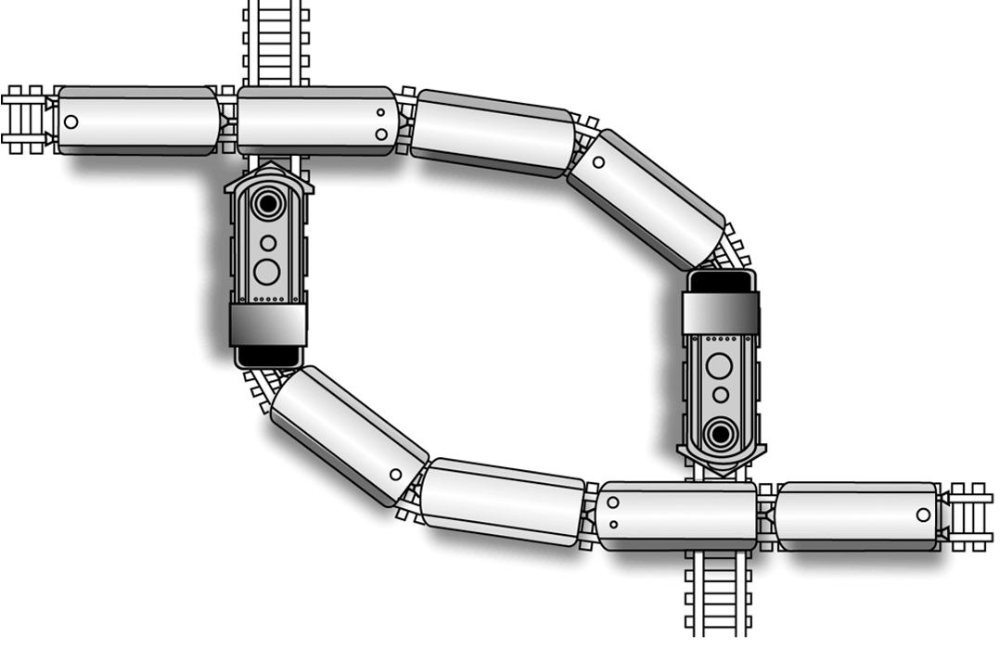

# Operating Systems (OS)
- The History of Operating Systems
- Operating System Architecture
- Coordinating the Machine’s Activities
- Handling Competition Among Processes
- Security
- Example: Windows, MacOS, UNIX, Linux, iOS, Android

# Functions of Operating Systems
- Control overall operation of computer
- Store and retrieve files
- Schedule programs for execution
- Coordinate the execution of programs

# Evolution of Shared Computing 
- Batch processing
- Interactive / real-time processing
- Time-sharing/ multitasking processing

# Batch Processing
- Data center computer operator
- First-in, first-out (FIFO)



# Interactive Processing
- OS with remote terminals
- Users interact with the computer through terminals to provide input and receive output
- Response time is critical


# Time-Sharing / Multitasking Processing
- Multiple tasks share the CPU simultaneously
- OS dividing CPU time into intervals and switches between tasks rapidly
- Only one task is being performed at any given time



# Software Classification
- System Software
  - Operating systems
  - Utility programs
- Application Software
  - Productivity software
  - Social media software



# Operating System Components
- Shell: communicates with users
  - Text based
  - Graphical user interface (GUI)
- Kernel: manages CPU, memory, and device
  - File manager (folder / path)
  - Device drivers (translator between OS and peripheral devices)
  - Memory manager (allocating / paging memory)
  - Scheduler and dispatcher (which is next to run / give CPU time)

  

# Getting Computers Started (Bootstrapping)
- Bootstrapping: process of starting a computer and loading the OS into memory



# Processes
- Program: a static set of directions
- Process: the activity of executing a program 
- Process state: a snapshot of the activity
  - Value of program counter: current position in the program being executed
  - Values in general purpose registers
  - Values of Associated memory cells
- Process table: maintain all process information in main memory
  - Memory area assigned to the process
  - Priority
  - Ready (process is ready to run) / Waiting (process is waiting for an event)

 # Process Administration
- **Scheduler**: maintains the process table
  - Adds new processes.
  - Removes completed processes.
  - Decides whether a process is ready or waiting.
- **Dispatcher**: really execute the processes
  - Controls the allocation of time slices to the processes 
  - Process switch (context switch) by calling interrupt when the end of a time slice occurs.

# Time-Sharing between 2 Processes
- The CPU switches between processes to maximize utilization and minimize idle time.



# Interrupts Handling
- Interrupt: a signal to the CPU indicating an event that needs immediate attention
- Steps
  - The CPU completes its current machine cycle
  - Save the current process’s state 
  - Execute interrupt handler, which is a part of the dispatcher
  - Selects the highest-priority READY process from the process table
  - Restarts the timer circuit and begins the next time slice

# Handling Competition among Processes
- If the competition is not handled properly, an race condition happens, which can lead to unpredictable or corrupted data



# Critical Section Problem
- Race condition is one of critical section problems.
- Solution of critical section problem is ensuring that only one process accesses shared resources at a time. 
- The code is generally partitioned into four sections
  - Entry section
  - Critical section / region
  - Exit section
  - Remainder section

# Test-and-Set Approach 
- The approach ensures that only one process at a time can execute in its critical section.
- Test-and-Set is an atomic instruction with hardware support (no interruption allowed).
- Semaphore is a control flag which  lock / unlock control to shared resources
- Critical region / section: A sequence of instructions that should be executed by only one process at a time
- Mutual exclusion: only one process at a time be allowed to execute a critical region

# Psudo Code of Test-and-Set approach
```python
# TestAndSet() is an atomic instruction with hardware support (no interruption allowed)
def Test_and_Set(lock):
  value = lock
  lock = True
  return value

shared data: lock = False # initial vale is False

while Test_and_Set(not lock):
  pass
# Execute critical section
lock = False
# Execute remainder section
```

# Deadlock
- Processes block each other from continuing
- Conditions required for deadlock
  - Competition for non-shareable resources.
  - Resources are requested on a partial basis; that is, having received some resources, a process will return later to request more.
  - Once a resource has been allocated; it cannot be forcibly retrieved.

# Deadlock Cases
- A deadlock resulting from competition for nonshareable railroad intersections
- Five philosophers sit around a table. Each needs both adjacent forks to eat, so they can eat only when both neighbors have put down both forks.

<div class="small-grid">
    
    
</div>

# Deadlock Detection and Avoidance
- Converting nonshareable resources (printer) into shareable ones (print queue)
- Requiring each process to request all its resources at one time
- Administrator uses his/her powers as “super-user” to forcibly retrieving some of the allocated resources

# Starvation and Aging
- Starvation: process cannot get the resources needed for a long time because the resources are being allocated to other processes.
- Aging: adding an aging factor to the priority of each request to prevent starvation.

# Security
- Problems
  - Insecure passwords
  - Unusual behavior
  - Sniffing software
  - Virus/worms/Trojan horses
- Counter measures
  - Auditing software (record and analyze activities)
  - Privilege levels & privileged instructions

