# Networking and the Internet
- Network Fundamentals
- The Internet
- The World Wide Web
- Internet Protocols
- Security

# Network Classifications by Scope
- Personal Area Network (PAN)
- Local Area Network (LAN)
- Metropolitan Area Network (MAN)
- Wide Area Network (WAN)
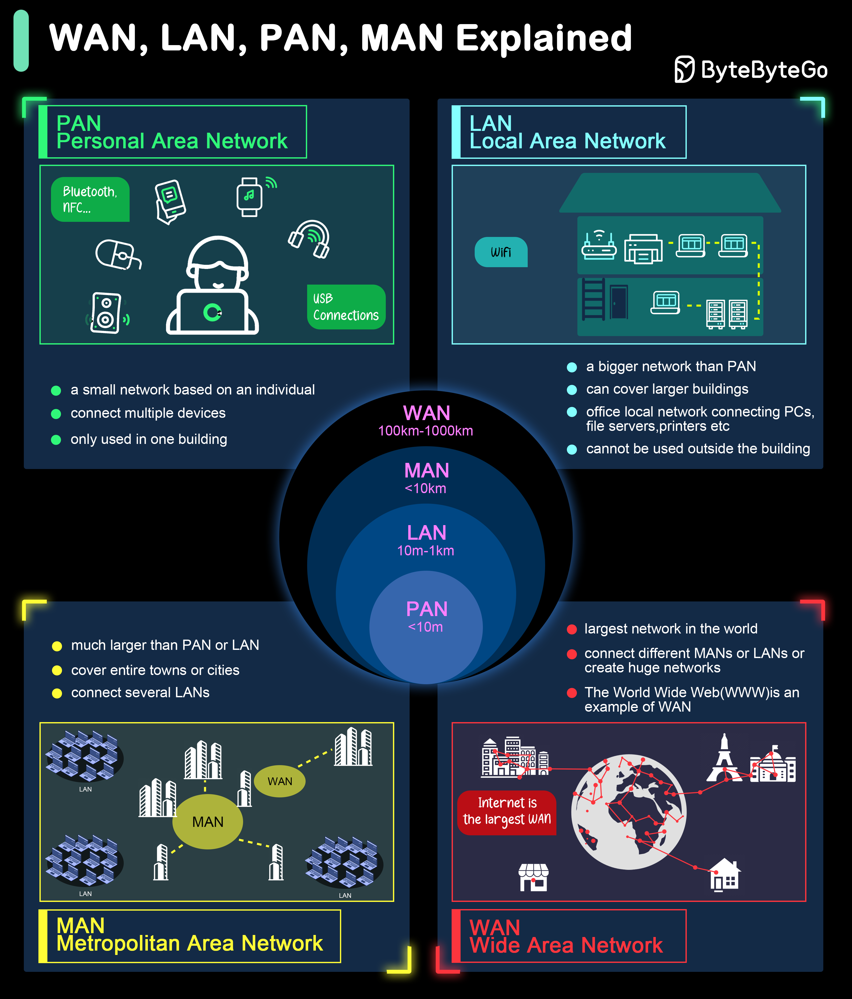

# Network Classifications by Ownership
- Private Network (Closed): corporate intranet
- Public Network (Open): Internet, Public Wi-Fi networks
- Hybrid Network (Combination of Private and Public): Online banking systems
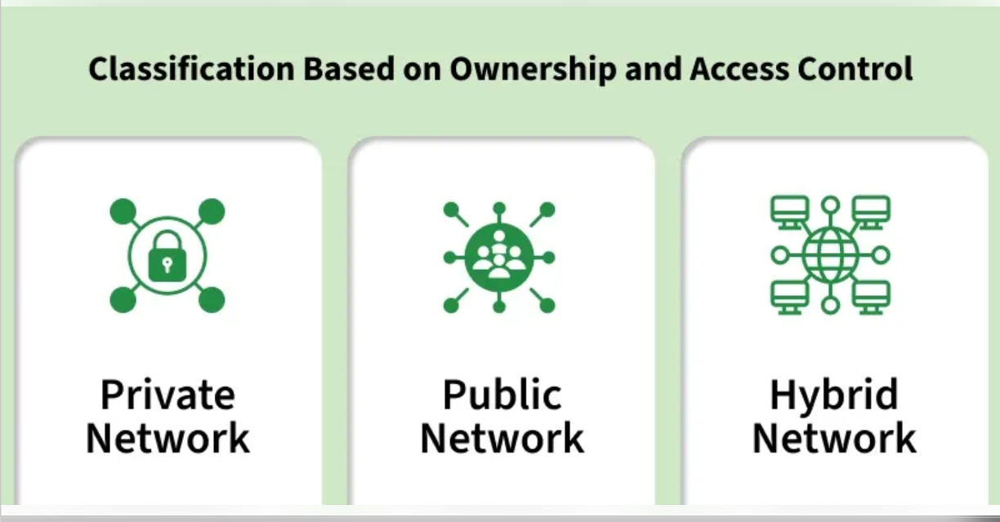

# Network Classifications by Internetwork
- Intranet: A private network accessible within an organization.
- Extranet: A controlled private network allowing access to external partners, vendors, or customers.
- Internet
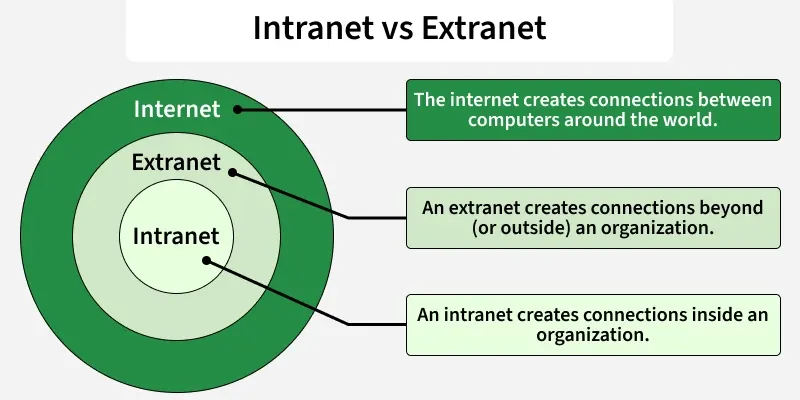

# Network Classifications by Topology
  - Bus (Ethernet)
  - Star (Wireless networks with central Access Point)
  - Ring (Token Ring)
  - Mesh (Multiple interconnected nodes)
  - Hybrid (Combination of different topologies)

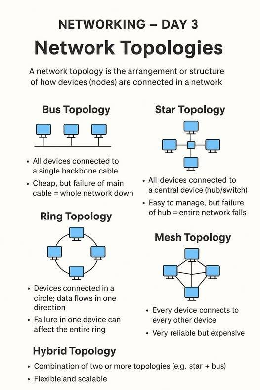

# Protocols - Token Ring
- Popular in ring topology.
- Token and messages are passed in one direction.
- Only the machine that gets the token can transmit its own message.

[](https://youtu.be/p72R2uGglnU)

# Protocols - CSMA/CD
CSMA/CD (carrier sense, multiple access with collision detection)
- Popular in bus topology (wired Ethernet).
- Broadcasting.
- When collision, both machines wait for a brief random time before trying again.

[](https://www.youtube.com/shorts/ltMPRvfzF-E?feature=share)  

# Protocols - CSMA/CA
CSMA/CA (carrier sense, multiple access with collision avoidance)
- Popular in wireless Ethernet. (WiFi)
- Broadcasting.
- Detect if a channel is idle, if so, wait for a brief random time and then detect again. If the channel is still idle, start sending.

[](https://www.youtube.com/shorts/CkTPDfvu69U?t=14&feature=share)  

# WiFi
- Wi-Fi is a Wireless Local Area Network (WLAN) technology that allows devices such as computers and smartphones to connect to a network using radio waves, without the need for physical network cables.
- IEEE 802.11 (n, ac, ax, ...)

|Wi-Fi Name|IEEE standard|Max speed|Year|Note
|---|---|---|---|---|
|Wi-Fi 4|802.11n|0.6 Gbps|2008|廣泛使用的前代規格|
|Wi-Fi 5|802.11ac|6.9 Gbps|2014|廣泛使用的前代規格|
|Wi-Fi 6|802.11ax|9.6 Gbps|2019|目前主流|
|Wi-Fi 7|802.11be|約 46 Gbps|2024|新一代規格|

# Access Points
- An access point (AP) is a networking device that allows wireless devices to connect to a wired network.

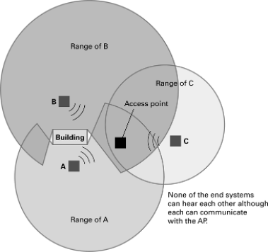

# Connecting Networks
- Hub
  - Broadcasting messages to all connected devices.
- Repeater
  - Simply passing through messages.
  - Connecting two **compatible** networks to extend network.
- Bridge
  - Only passing those messages addressed to the other side.
  - Connecting two **compatible** networks more efficiently.
- Switch
  - A bridge with multiple connections
  - Connecting several **compatible** networks more efficiently.
- Router: Connects two **incompatible** networks resulting in a network of networks called an internet

# Hubs
A hub broadcasts messages to all connected devices.
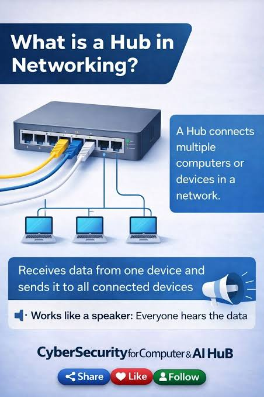

# Repeaters
A repeater receives a signal and retransmits it to extend the network's range.
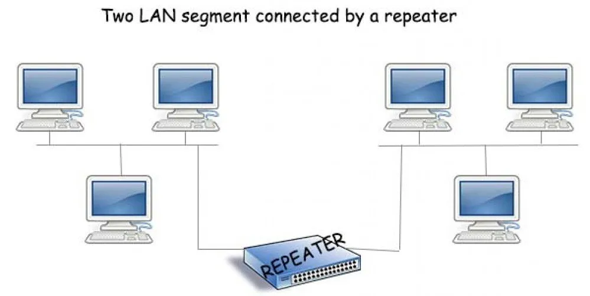

# Bridges
A bridge connects two compatible networks and forwards only messages addressed to the other side.

[](
https://www.youtube.com/shorts/qu3iaqLqKXo?feature=share)

# Switches
A switch is a bridge with multiple connections.

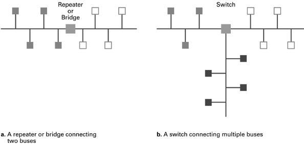

# Routers
- A router connects two or more incompatible networks, creating an internet.
- Most come with firewall management.

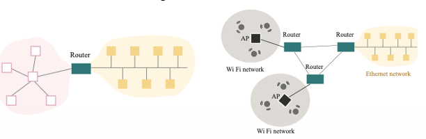
> Router connecting two different topology networks
> Routers connecting two WiFi networks and an Ethernet network to form an internet

# Inter-process Communication
- Client-server
  - One server, many clients
  - Server must execute continuously to serve clients.
  - Client initiates communication by sending requests.
- Peer-to-peer (P2P)
  - No dedicated server, two processes communicating as equals
  - Peers communicate directly with one another.
  - Peers can join and leave the network dynamically.

# Illustration of Client-Server and P2P
- Client-Server
  - Web server
  - Email server
  - File server
  - Database server
- Peer-to-Peer
  - File sharing  
  - Blockchain networks
  - VoIP calls

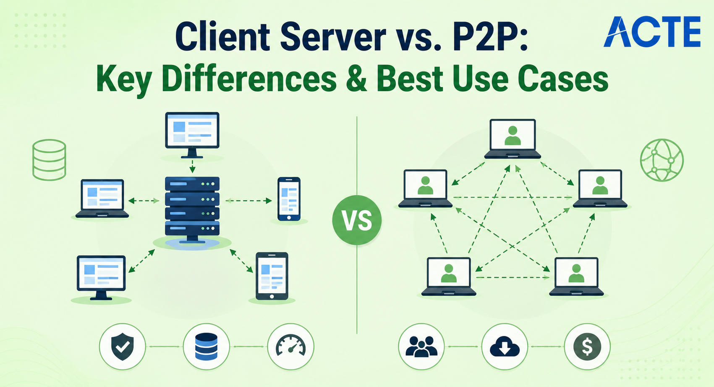

# The Internet
- The most notable example of an internet is the Internet.
- Original goal was to prevent disruptions caused by local disaster.
  - Deviated from the advanced research projects agency network (ARPANet) around 1960.
  - 4 nodes — UCLA, SRI, UCSB, UTAH,
- Now it‘s a commercial undertaking.

# Internet Architecture
- Domain: A portion of the Internet that is a network or internet controlled by a single authority
- Gateway: Connected to the rest of the Internet by a router called a gateway
- Internet Corporation for Assigned Names & Numbers (ICANN): Oversees the registration of domains

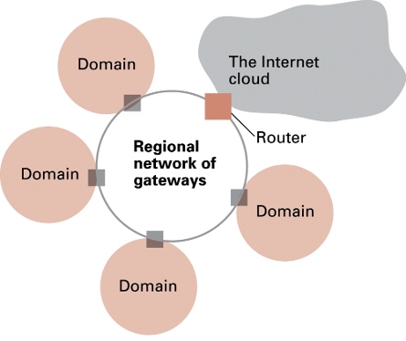

# Internet Composition
Internet Service Provider (ISP) allows customers to connect their domain to the ISP‘s equipment or join the domain already established by the ISP.
- Tier-1 ISP: International connection, AT&T, NTT
- Tier-2 ISP: Regional connection - HiNet
- Access ISP: Provides connectivity to the Internet - HiNet, TFN
  
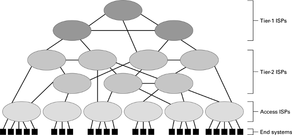

# Connect to Access ISP
- Dial up by telephone
- Cable connections
- DSL, uses existing telephone lines to provide Internet access through an ISP. (ADSL)
- Wireless, 4G and 5G

# Internet Addressing: IP Addresses
- IP (Internet protocol) addresses
  - 32 bits in IPv4 (eg. 140.112.18.33)
  - 128 bits in IPv6 (eg. 2001:0db8:85a3:0000:0000:8a2e:0370:7334)
- Network identifier (by ICANN)
- Host address (domain administrator)
- Private IPv4 addresses are reserved for use within local networks and are not directly routable on the public Internet.
  - 10.x.x.x
  - 172.16.x.x
  - 192.168.x.x

# Internet Addressing: Host Name  
- Domain name: assigned by a registrar, eg. GoDaddy is one of the ICANN-approved registrars
- Domain name example: nycu.edu.tw
  - Top-level domain: .com .au
  - Second-level domain: nycu
- Individual host names: assigned by domain owner
  - Example: **www**.nycu.edu.tw
- Translation between mnemonic addresses and IP addresses handled by domain name servers (DNS)
- www.nycu.edu.tw --> 104.18.31.227  

# Domain name registration in Taiwan 
- Domain name registration in Taiwan is overseen by the Taiwan Network Information Center (TWNIC).
- In Taiwan, TWNIC manages the .tw top-level domain, while authorized domain registrars such as HiNet, Net-Chinese, and PChome provide domain name registration services.

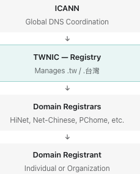

# Traditional Internet Applications
- WWW (World Wide Web)
- Email
- File transfer
- Remote login
- Instant Messaging
- Voice over IP
- Video conferencing
- Streaming
- E-commerce
- Cloud computing
- Online gaming

# World Wide Web (WWW)
Web servers store hypertext documents and serve them to clients (browsers) upon request.
- Hypertext is a way to link documents together using hyperlinks.
- HTTP (Hypertext Transfer Protocol) is the protocol used for transferring hypertext documents on the Web.
- Documents uniquely identified by URLs

# URL (Uniform Resource Locator)
- URL is the address used to access resources on the Internet.
- Example: https://www.nycu.edu.tw/nycu/ch/index
  - https: indicates the protocol used to access the resource
  - www: host name
  - .nycu.edu.tw: domain name
  - /nycu/ch/index: the path to the specific resource on the server
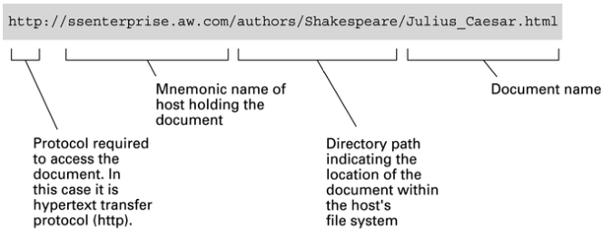

# Hypertext Document Format
- Encoded as text file
- Contains tags to communicate with browser
```text
Appearance
  <h1> to start a level one heading </h1>
  <p> to start a new paragraph </p>

Links to other documents and content
  <a href = . . . > </a>

Insert images
   </img>
```  
[HTML example](asset/html/index.html)

# Internet Protocol
- Layers
  - Application: constructs message with address
  - Transport: chops message into packets
  - Network: handles routing through the Internet
  - Link: handles actual transmission of packets
- For OSI 7-layer model, check out http://en.wikipedia.org/wiki/OSI_model.
- Port (not the I/O port)
  - Port numbers are used by the transport layer to direct incoming messages to the correct application.
  - Using port numbers to determine application units
  - Incoming messages are delivered to different applications by unique port numbers.
  -  Some typical ports: ftp (21), telnet (23), ssh (22), http (80), etc.
  
# Internet Software Layers (1/2)
- Application Layer: Creates Messages for Communication
  - Provides Internet services to applications.
  - Constructs messages for transmission over the Internet.
  - Uses DNS to translate domain names into IP addresses.

- Transport Layer: Divides Messages into Segments
  - Divides large messages into smaller segments.
  - Uses sequence numbers to support proper reassembly (TCP).
  - Manages end-to-end communication between applications.

# Internet Software Layers (2/2)
- Network Layer: Routes Packets Across Networks
  - Determines how packets travel from source to destination.
  - Uses IP addresses to identify sending and receiving devices.
  - Forwards packets through interconnected networks.
- Link Layer: Transmits Data Over a Network Link
  - Transfers data between devices on the same network link.
  - Transfers data between devices on the same network link.
  - Uses hardware addresses (MAC addresses) when applicable.
  - Handles framing and error detection.

# Package Shipping
- In package shipping, a sender wants to send a package to a receiver.

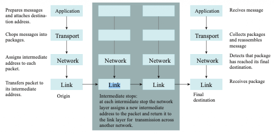

# TCP / IP Suite
- Transport Layer
  - TCP (transmission control protocol)
  - UDP (user datagram protocol): no notification before sending message, no retransmission service, no acknowledge of receiving
    message.
- Network Layer: routing based on IP (IPv4 and IPv6)
- TCP and IP are two protocols, TCP/IP refers to a collection of protocols more than just TCP and IP.
  - TCP: more reliable, less efficient
  - UDP: more efficient, less reliable

# Security
- Attacks
  - Malware (malicious software): virus, worm, Trojan horse, spyware, phishing
  - Denial of service (DoS)
  - Spam

- Protections
  - Firewall
  - Spam filter
  - Proxy
  - Antivirus

# Encryption
- Encryption is used to protect data during transmission.
- Symmetric encryption: same key for encryption and decryption.
- Asymmetric encryption: public key for encryption, private key for decryption.

# Transmisison Protection
- SSL/TLS is a security protocol that encrypts communication between a client and a server, protecting sensitive information such as passwords and personal data.
- sFTP, HTTPs, SSH

[](
https://youtu.be/sEkw8ZcxtFk)

[](
https://youtu.be/Kw2P1RR-3k8)


# Asymmetric Encryption
- Asymmetric encryption uses a pair of keys: a public key for encryption and a private key for decryption.
- The public key can be shared with anyone, while the private key must be kept secret.
- Common asymmetric encryption algorithms include RSA and ECC (Elliptic Curve Cryptography).
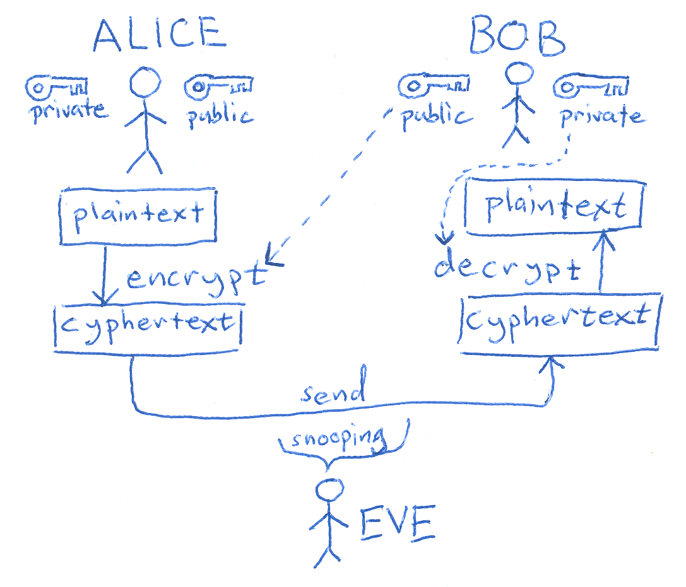

# RSA Algorithms

[](
https://youtu.be/fBtnqkVSg_I?si=4WDLxdaAJYt1aVSP)
